<div align="center">

                                                 ```
 ████████╗██████╗  █████╗  ██████╗███████╗██╗  ██╗
 ╚══██╔══╝██╔══██╗██╔══██╗██╔════╝██╔════╝╚██╗██╔╝
    ██║   ██████╔╝███████║██║     █████╗   ╚███╔╝
    ██║   ██╔══██╗██╔══██║██║     ██╔══╝   ██╔██╗
    ██║   ██║  ██║██║  ██║╚██████╗███████╗██╔╝ ██╗
    ╚═╝   ╚═╝  ╚═╝╚═╝  ╚═╝ ╚═════╝╚══════╝╚═╝  ╚═╝
```

### ⛓ Follow the money. Map the chain. Prove the path. ⛓

**Blockchain forensics & AML tracing for Bitcoin and Ethereum — with interactive graphs, flow diagrams and court-ready exports.**

*By Aniket Misra*

    

</div>

---

## Table of contents

1. [What is TraceX?](#1-what-is-tracex)
2. [What TraceX is **not**](#2-what-tracex-is-not)
3. [Feature overview](#3-feature-overview)
4. [See it in action](#4-see-it-in-action)
5. [Quick start](#5-quick-start)
6. [Installation & setup](#6-installation--setup)
7. [Usage & CLI reference](#7-usage--cli-reference)
8. [How TraceX works](#8-how-tracex-works)
9. [Blockchain primer: the structures TraceX reads](#9-blockchain-primer-the-structures-tracex-reads)
10. [Forensic heuristics in detail](#10-forensic-heuristics-in-detail)
11. [Taint propagation](#11-taint-propagation)
12. [Risk scoring model](#12-risk-scoring-model)
13. [Entity labels](#13-entity-labels)
14. [Data providers](#14-data-providers)
15. [Reports & export formats](#15-reports--export-formats)
16. [Project layout](#16-project-layout)
17. [Limits, accuracy & false positives](#17-limits-accuracy--false-positives)
18. [Development & testing](#18-development--testing)
19. [Roadmap](#19-roadmap)
20. [Legal, ethics & responsible use](#20-legal-ethics--responsible-use)
21. [License & author](#21-license--author)

---

## 1. What is TraceX?

TraceX is a command-line **blockchain investigation toolkit**. Give it an address or transaction id and it will:

1. **Pull public ledger data** (Bitcoin via any Esplora API, Ethereum via Etherscan, or the built-in offline demo).
2. **Build a transaction graph** that maps who paid whom, how much, and when.
3. **Walk the graph** forward (where did the money go?) and backward (where did it come from?) up to a chosen depth.
4. **Apply forensic heuristics**: address clustering, change-output detection, peel-chain detection, CoinJoin / mixer detection, rapid pass-through (layering) detection.
5. **Overlay entity labels you supply** (exchanges, sanctioned addresses, ransomware wallets, darknet-market addresses, mixers, …).
6. **Propagate taint** and compute an **explainable 0–100 risk score**.
7. **Emit reports in many formats**: a self-contained interactive HTML dashboard, Markdown with Mermaid flow diagrams, JSON, CSV, GraphML, GEXF, Graphviz DOT, and Neo4j Cypher — plus a SHA-256 manifest for evidence integrity.

The typical use case is tracing the proceeds of ransomware, fraud, hacks or **darknet-market activity** through the public blockchain until they touch a labeled entity such as an exchange, mixer or sanctioned wallet — the same workflow used by compliance teams, journalists, incident responders and academic researchers.

## 2. What TraceX is **not**

Being explicit about this matters, both for correctness and for responsible use:

| TraceX does **not** | Why |
|---|---|
| Crawl, scrape or connect to Tor hidden services / `.onion` sites | It reads **public blockchains only**. The "dark web" link is the *money*, which is public. |
| De-anonymize people or link addresses to real-world identities | Attribution comes solely from **labels you provide** (e.g. the OFAC list, vendor exports, case notes). |
| Ship real-world address attributions | A wrong label can harm an innocent party; you must source and vet your own. |
| Prove wrongdoing | Heuristics produce **investigative leads**, not evidence of guilt. See [§17](#17-limits-accuracy--false-positives). |
| Sign or broadcast transactions, or hold keys | It is strictly **read-only**. |

## 3. Feature overview

| Area | Capability |
|---|---|
| **Tracing** | Forward / backward / bidirectional BFS, depth limit, node cap, dust filter, date window, hub detection, stop-at-exchange logic |
| **Chains** | Bitcoin (UTXO model) and Ethereum (account model, incl. internal transfers) normalised into one graph model |
| **Clustering** | Common-input-ownership (CIOH) with CoinJoin exclusion to avoid false mega-clusters |
| **Pattern detection** | CoinJoin, peel chains, change outputs, consolidation, fan-out, rapid pass-through |
| **Attribution** | CSV / JSON label packs, confidence scores, cluster-level label inheritance |
| **Taint** | Haircut (proportional) and Poison (worst-case) models |
| **Risk** | Explainable noisy-OR score with per-factor breakdown |
| **Interactive report** | Force & layered graph, filters, search, color-by (category / cluster / taint / hop), node inspector, ribbon flow diagram, timeline, sortable tables — **one offline file, zero CDN** |
| **Diagrams** | Mermaid flowchart, Sankey, sequence, peel-chain and cluster diagrams (render natively on GitHub) |
| **Exports** | JSON, CSV ×4, GraphML, GEXF, DOT, Cypher, Markdown, HTML |
| **Integrity** | `manifest.json` with SHA-256 of every output, parameters and label sources |
| **Safety** | HTTPS-only, secrets never cached or logged, output escaping + CSP, CSV formula-injection guard — see [SECURITY.md](SECURITY.md) |
| **Footprint** | Standard-library only. No runtime dependencies. |

## 4. See it in action

> All screenshots come from the built-in **synthetic** demo scenario ("Operation DemoLocker"). Every address, name and amount is fictional.

**Overview — risk gauge, factor breakdown, value per category, flow matrix**
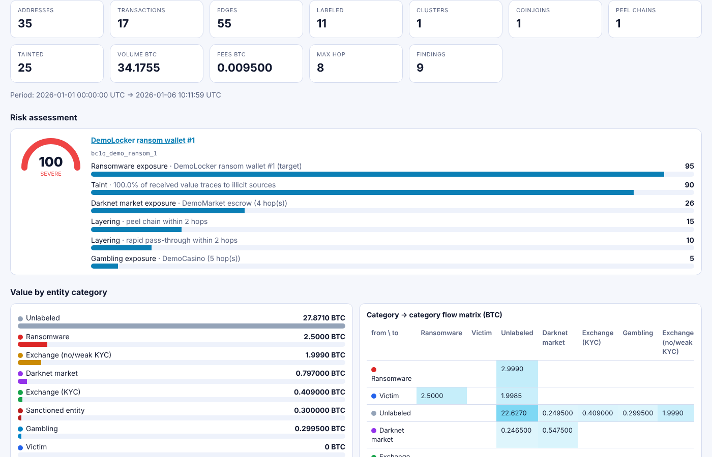

**Interactive graph — drag, zoom, filter, inspect**
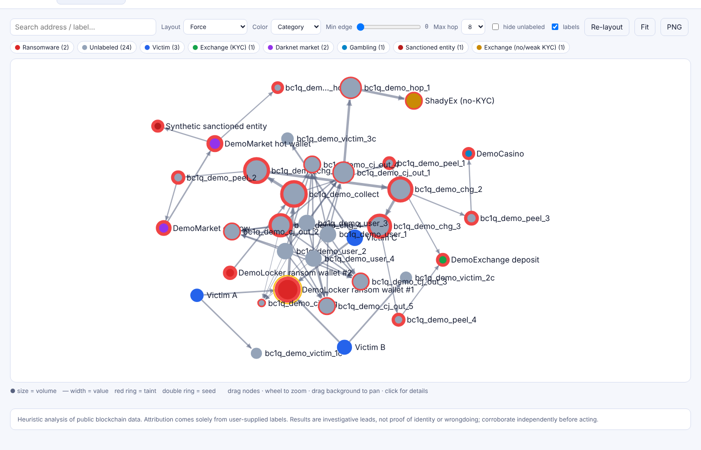

**Layered flow diagram — ribbons show value moved hop by hop**
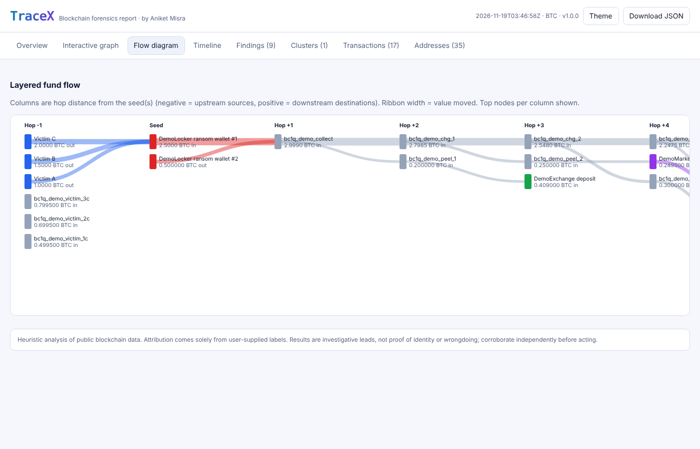

**Timeline** (orange = CoinJoin, purple = peel chain)
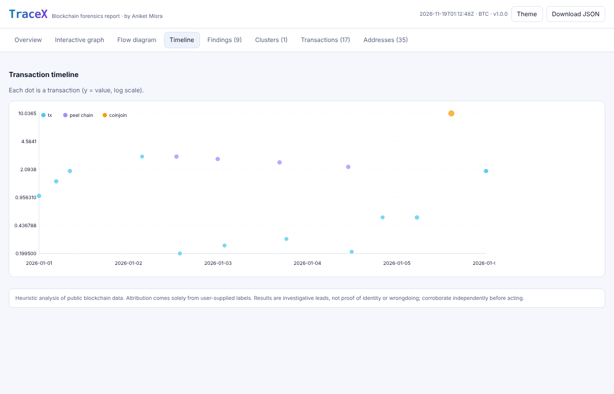

**Findings**
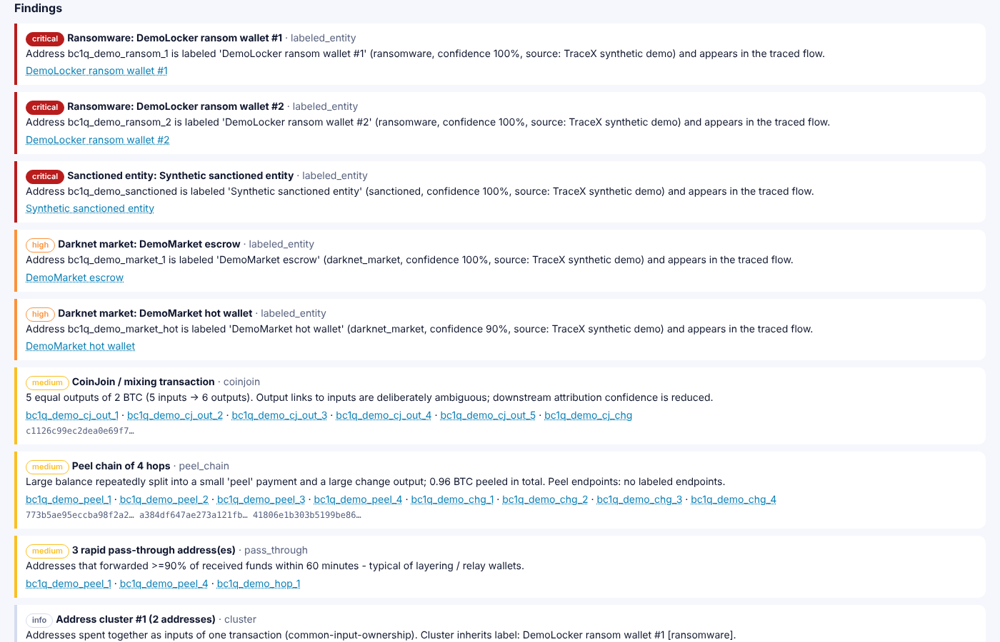

A pre-generated copy of every output lives in [`examples/demo-output/`](examples/demo-output/) (open `report.html` in a browser, or read [`report.md`](examples/demo-output/report.md)).

The Sankey generated by the demo (Mermaid, hop-layered):

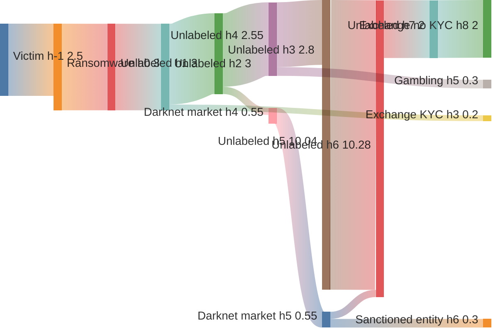

The peel chain the tool detected in the demo data:

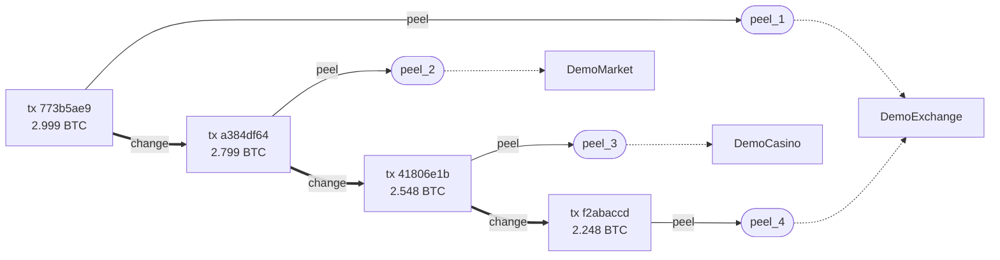

## 5. Quick start

```bash
git clone https://github.com/<your-username>/tracex.git
cd tracex
python3 -m venv .venv && source .venv/bin/activate
pip install -e .

tracex demo                      # offline, no API keys, writes ./tracex-demo/
open tracex-demo/report.html     # macOS  (Linux: xdg-open · Windows: start)
```

You will see the start-up banner:

```
 ████████╗██████╗  █████╗  ██████╗███████╗██╗  ██╗
 ╚══██╔══╝██╔══██╗██╔══██╗██╔════╝██╔════╝╚██╗██╔╝
    ██║   ██████╔╝███████║██║     █████╗   ╚███╔╝
    ██║   ██╔══██╗██╔══██║██║     ██╔══╝   ██╔██╗
    ██║   ██║  ██║██║  ██║╚██████╗███████╗██╔╝ ██╗
    ╚═╝   ╚═╝  ╚═╝╚═╝  ╚═╝ ╚═════╝╚══════╝╚═╝  ╚═╝

  ⛓  Follow the money. Map the chain. Prove the path.  ⛓
  v1.0.0   ·   By Aniket Misra
```

(coloured with a cyan→violet gradient in a real terminal; use `--no-banner` or `NO_COLOR=1` to hide/disable it.)

## 6. Installation & setup

**Requirements:** Python **3.9+**, `git`. No third-party runtime packages.

### Linux / macOS

```bash
git clone https://github.com/<your-username>/tracex.git
cd tracex
python3 -m venv .venv
source .venv/bin/activate
pip install --upgrade pip
pip install -e .                 # installs the `tracex` command
tracex --version
```

### Windows (PowerShell)

```powershell
git clone https://github.com/<your-username>/tracex.git
cd tracex
py -m venv .venv
.\.venv\Scripts\Activate.ps1
pip install -e .
tracex --version
```

### Developer install (tests + linter)

```bash
pip install -e ".[dev]"
pytest                           # 16 tests
ruff check src tests
```

### Docker

```bash
docker build -t tracex .
docker run --rm -v "$PWD/out:/out" tracex demo -o /out
# live trace with labels and an API key passed via the environment (never bake keys into images):
docker run --rm -v "$PWD:/work" -w /work -e ETHERSCAN_API_KEY tracex \
    trace 0xYourAddress --chain eth -l labels.csv -o /work/out
```

### Optional configuration

| Variable | Purpose |
|---|---|
| `ETHERSCAN_API_KEY` | Required for `--chain eth` (`export ETHERSCAN_API_KEY=...`) |
| `TRACEX_CACHE_DIR` | Override cache dir (default `~/.cache/tracex`) |
| `NO_COLOR=1` | Disable ANSI colour in the banner |
| `HTTPS_PROXY` | Honoured by Python's urllib; or pass `--proxy` |

## 7. Usage & CLI reference

```text
tracex demo                         run the offline synthetic scenario
tracex trace <seed...> [options]    trace live addresses / txids
tracex labels <file...>             validate label files
tracex categories                   list categories + base risk weights
```

### Examples

```bash
# 1. Bitcoin address, 4 hops both ways, with your label pack
tracex trace bc1q... -d 4 -l labels.csv -o case-001

# 2. Follow the money forward only from a ransom payment transaction
tracex trace <64-hex-txid> --direction forward -d 6 -l ofac.csv -l vendor.json

# 3. Ignore dust and restrict to a time window
tracex trace 1BoatSLRHtKNngkdXEeobR76b53LETtpyT --min-value 0.001 --since 2026-01-01 --until 2026-06-30

# 4. Ethereum
export ETHERSCAN_API_KEY=...
tracex trace 0xabc... --chain eth -d 3 -l eth-labels.csv

# 5. Only some formats; worst-case (poison) taint
tracex trace bc1q... -f html json graphml --taint-mode poison

# 6. Your own self-hosted Esplora node (best for privacy)
tracex trace bc1q... --esplora-url https://my-node.example.org/api
```

### Options

| Option | Default | Meaning |
|---|---|---|
| `--chain` | `btc` | `btc ltc bch doge eth` (live providers exist for `btc` & `eth`) |
| `-d, --depth` | `3` | Max hops from each seed |
| `--direction` | `both` | `forward`, `backward`, `both` |
| `--max-txs` | `200` | Max transactions pulled per address |
| `--max-nodes` | `1500` | Hard cap on graph size |
| `--min-value` | `0` | Dust filter, in whole coins |
| `--hub-threshold` | `1000` | Addresses with more lifetime txs are marked *hub* and not expanded |
| `--since / --until` | – | `YYYY-MM-DD` window |
| `--taint-mode` | `haircut` | `haircut` or `poison` |
| `--taint-source ADDR` | – | Extra address to treat as 100 % tainted (repeatable) |
| `-l, --labels FILE` | – | CSV/JSON label file (repeatable) |
| `-o, --out DIR` | `tracex-report` | Output directory |
| `-f, --formats` | `all` | `html md json csv graphml gexf dot mermaid cypher` |
| `--provider` | auto | `esplora`, `etherscan`, `demo` |
| `--esplora-url` | blockstream.info | Any Esplora-compatible HTTPS endpoint |
| `--proxy URL` | – | HTTP(S) proxy for provider traffic |
| `--no-cache` | off | Disable the on-disk response cache |
| `-v` | off | Verbose progress |
| `--no-banner` | off | Hide the banner |

Exit codes: `0` ok · `1` no data found · `2` provider/config error.

## 8. How TraceX works

### 8.1 Architecture

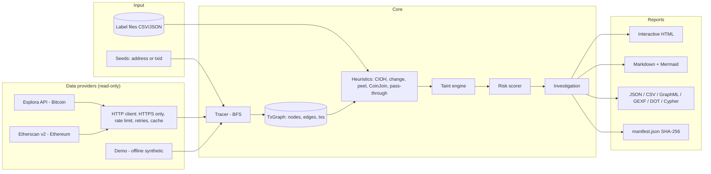

### 8.2 Pipeline sequence

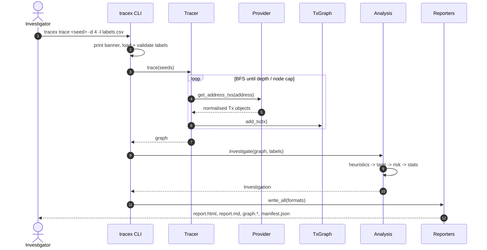

### 8.3 Tracing algorithm

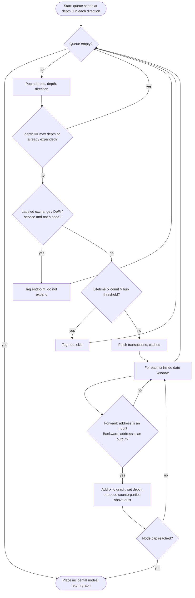

### 8.4 Core data model

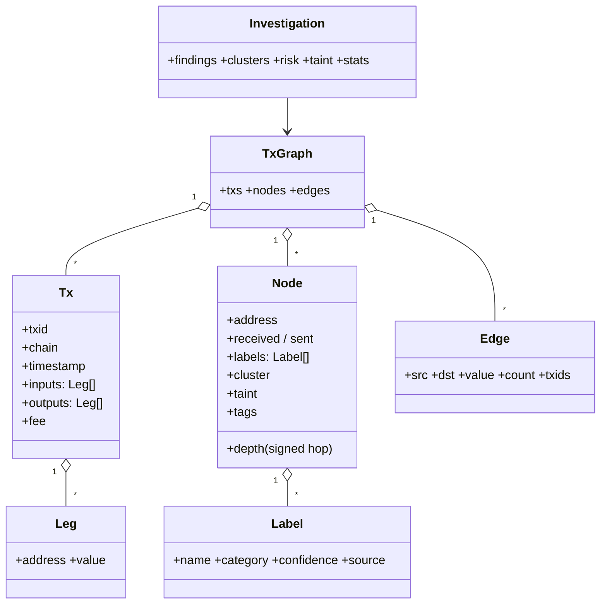

### 8.5 From transactions to edges

A UTXO transaction has many inputs and outputs, so "who paid whom" is ambiguous. TraceX uses **proportional attribution**: every input funds every output in proportion to value.

```
        inputs                         outputs
   A  100 ─┐                     ┌─ C  200
           ├──►  [ tx ]  ──►─────┤
   B  300 ─┘      fee 10         └─ D  190

   edge(A→C) = 100 × 200 / 400 = 50      edge(B→C) = 300 × 200 / 400 = 150
   edge(A→D) = 100 × 190 / 400 = 47.5    edge(B→D) = 300 × 190 / 400 = 142.5
```

Self-transfers (change returned to an input address) are skipped. A single transaction with more than 2 500 input×output pairs is truncated to its 50 largest inputs/outputs.

## 9. Blockchain primer: the structures TraceX reads

### 9.1 Chain of blocks

Each block commits to its predecessor by hash, so history cannot be altered without redoing all later work.

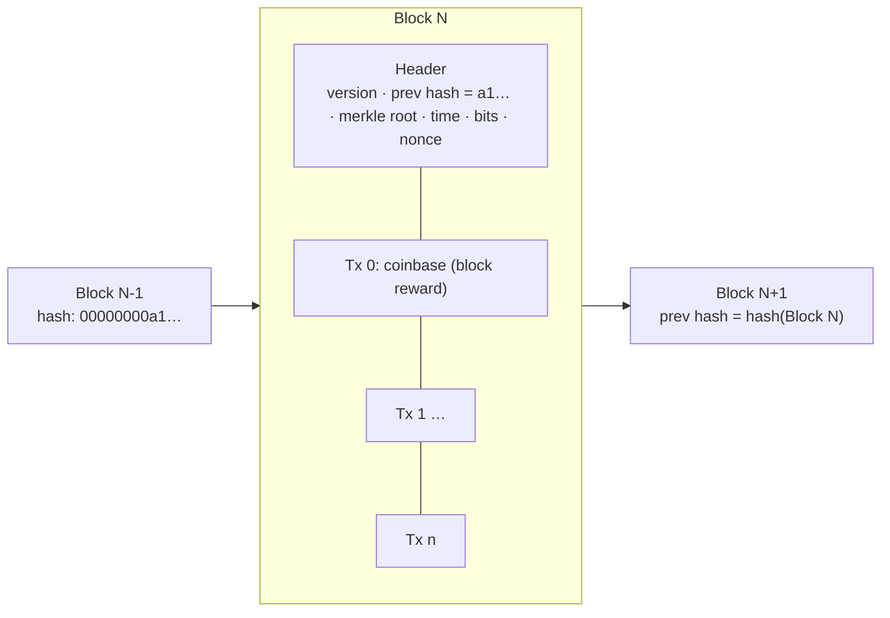

### 9.2 Bitcoin block layout

```
┌───────────────────────────── BLOCK ──────────────────────────────┐
│ HEADER (80 bytes)                                                │
│   version       4 B   protocol/feature bits                      │
│   prev_hash    32 B   hash of previous block header  ◄── chain   │
│   merkle_root  32 B   commitment to every tx in the block        │
│   time          4 B   unix timestamp (TraceX uses this)          │
│   bits          4 B   compact difficulty target                  │
│   nonce         4 B   proof-of-work counter                      │
├──────────────────────────────────────────────────────────────────┤
│ tx_count (varint)                                                │
│ TX 0  coinbase  ─ no real inputs, creates new coins + fees       │
│ TX 1  ┌ inputs[]  ─ each spends a previous output (txid, vout)   │
│       └ outputs[] ─ each = value + locking script (→ address)    │
│ …                                                                │
└──────────────────────────────────────────────────────────────────┘
```

### 9.3 Merkle tree (why a header commits to all transactions)

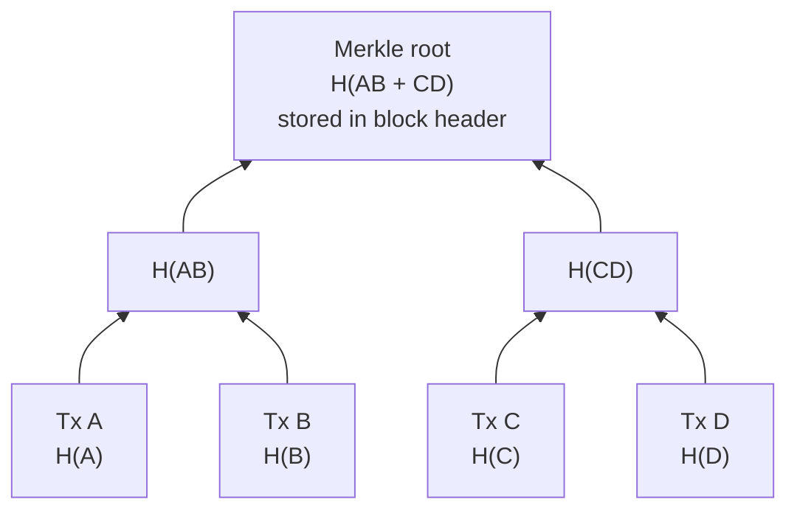

### 9.4 Anatomy of a Bitcoin transaction

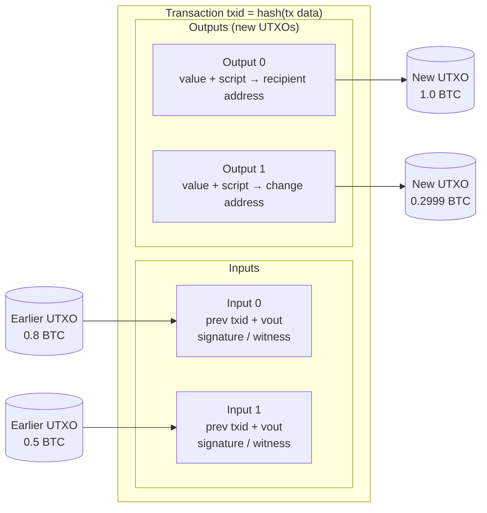

`fee = Σ inputs − Σ outputs` (here 1.3 − 1.2999 = 0.0001 BTC). TraceX reads each input's *prevout* (address + value) and each output (address + value) from the Esplora API.

### 9.5 The UTXO model: coins are consumed and re-created

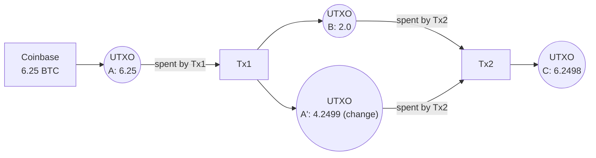

Because a transaction may spend several UTXOs, the *inputs of one transaction are probably controlled by the same entity* — the basis of the clustering heuristic in §10.1.

### 9.5 Ethereum: the account model

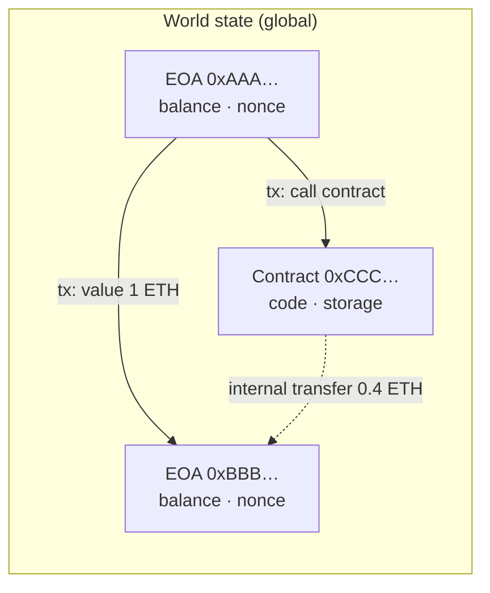

An Ethereum transaction has exactly **one sender and one receiver**, so edges are trivial; TraceX also ingests **internal transactions** (contract-initiated transfers) so mixers and routers aren't invisible. Token (ERC-20) tracing is on the [roadmap](#19-roadmap).

### 9.6 How TraceX normalises both models

| Concept | Bitcoin (UTXO) | Ethereum (account) | TraceX `Tx` |
|---|---|---|---|
| Senders | many input addresses | `from` | `inputs: [Leg(address, value)]` |
| Receivers | many output addresses | `to` | `outputs: [Leg(address, value)]` |
| Unit | satoshi (10⁻⁸) | wei (10⁻¹⁸) | integer base units, converted for display |
| Fee | Σin − Σout | gasUsed × gasPrice | `fee` |
| Time | block time | block timestamp | `timestamp` (UTC epoch) |

## 10. Forensic heuristics in detail

> Every heuristic is probabilistic. Findings are labeled in reports so analysts can weigh them.

### 10.1 Common-input-ownership clustering (CIOH)

If a transaction spends inputs from addresses A and B, the signer must have held the keys to both, so **A and B are very likely one entity**. TraceX merges addresses with a union-find structure and reports each group as a *cluster*; if any member is labeled, the cluster inherits that label ("entity attribution by co-spend").

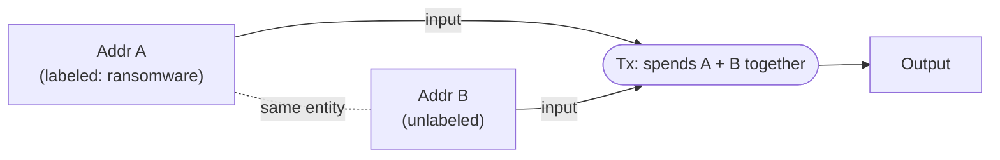

**Exclusion:** CoinJoins are *deliberately* multi-party, so TraceX never clusters their inputs (otherwise unrelated users merge into mega-clusters — a classic false-positive).

### 10.2 CoinJoin detection

Signature of equal-output CoinJoins (Whirlpool, Wasabi, JoinMarket-style): ≥3 inputs from ≥3 distinct addresses, and the most common output value appears ≥3 times and in ≥50 % of outputs.

```
 inputs (5 parties)                outputs
 chg_4  2.037 ──┐              ┌── 2.0  ◄─ indistinguishable
 user_1 2.0   ──┤              ├── 2.0  ◄─ indistinguishable
 user_2 2.0   ──┼──► [ JOIN ] ─┼── 2.0  ◄─ indistinguishable
 user_3 2.0   ──┤              ├── 2.0  ◄─ indistinguishable
 user_4 2.0   ──┘              ├── 2.0  ◄─ indistinguishable
                               └── 0.0365 (change)
```
Outcome: a `medium` finding, a `coinjoin-output` tag on outputs, a risk bonus, and **taint dilution** (haircut taint splits across participants).

### 10.3 Change-address detection (2-output transactions)

Votes for the output that is the **change**:

| Signal | Points to |
|---|---|
| Address first seen in this very transaction | that output = change |
| The other output is a round amount (multiple of 0.001) | the non-round output = change |
| Output script type equals the inputs' script type | that output = change |

Ties return nothing. Confidence = votes / 3.

### 10.4 Peel-chain detection

A holder repeatedly sends a *small payment* ("peel") and returns the large remainder to a fresh change address, hopping through many txs to launder or slowly cash out.

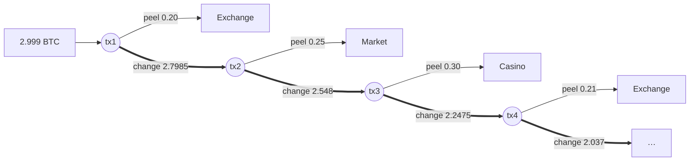

Rule: ≤2 input addresses, exactly 2 outputs, small ≤ 50 % of large, and the large (change) output is spent in the next qualifying step. Chains of **≥ 3 hops** are reported, with all peel endpoints and the total peeled.

### 10.5 Rapid pass-through (layering)

Non-service addresses that receive funds and forward **≥ 90 % within 60 minutes** are tagged `pass-through` — typical of relay wallets.

### 10.6 Other patterns

| Pattern | Rule | Severity |
|---|---|---|
| Consolidation | ≥10 inputs → ≤2 outputs | low |
| Fan-out | ≥10 outputs from ≤2 senders | low |
| Labeled entity in flow | label weight ≥ 0.5 (≥ 0.9 = critical) | high / critical |

## 11. Taint propagation

Question answered: *"What fraction of this address's funds can be traced to an illicit source?"* Transactions are processed in chronological order.

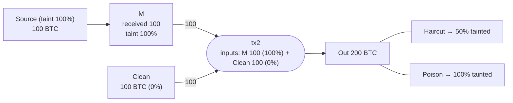

| Model | Formula | Use when |
|---|---|---|
| **haircut** | output taint = Σ(input value × input taint) / Σ input value | proportional, defensible attribution |
| **poison** | any tainted input ⇒ all outputs 100 % tainted | strict compliance / worst-case screening |

Sources are labeled addresses with category weight ≥ 0.7 (sanctioned, ransomware, theft, darknet market, scam) plus any `--taint-source`.

## 12. Risk scoring model

The score is explainable: every point comes from a listed factor, combined as **noisy-OR** (independent risks compound but never exceed 100).

```
score = round( 100 × (1 − Π (1 − cᵢ)) ),   cᵢ ∈ [0, 0.99]
```

### 12.1 Exposure factors

For each labeled entity reachable within 5 hops of the target (undirected):

`c = category_weight × label_confidence × hop_factor`

| Hop | 0 (target) | 1 (direct) | 2 | 3 | 4 | 5 |
|---|---|---|---|---|---|---|
| factor | 1.00 | 1.00 | 0.90 | 0.55 | 0.30 | 0.15 |

Only the strongest contribution per category is kept.

| Category | Weight | Category | Weight |
|---|---|---|---|
| sanctioned | 1.00 | exchange (no KYC) | 0.40 |
| ransomware | 0.95 | gambling | 0.30 |
| theft / hack | 0.90 | DeFi | 0.10 |
| darknet market | 0.85 | exchange (KYC) | 0.05 |
| scam | 0.80 | other service | 0.05 |
| mixer | 0.60 | victim / unlabeled | 0.00 |

### 12.2 Additional factors

| Factor | Contribution |
|---|---|
| Taint of the target (haircut/poison) | `0.9 × taint` |
| CoinJoin within 2 hops | 0.25 |
| Peel chain within 2 hops | 0.15 |
| Rapid pass-through within 2 hops | 0.10 |

### 12.3 Levels

| Score | Level |
|---|---|
| 0–19 | 🟢 low |
| 20–49 | 🟡 medium |
| 50–74 | 🟠 high |
| 75–100 | 🔴 severe |

Weights live in `labels.py` and `risk.py` — tune them to your institution's risk appetite.

## 13. Entity labels

TraceX ships **no real attributions**. Provide labels as CSV or JSON; load several with repeated `-l`.

**CSV** (`examples/labels.sample.csv`)

```csv
address,name,category,source,confidence,notes
bc1q_example_invalid_address_1,Example Exchange hot wallet,exchange_kyc,my-case-notes,0.9,
0xexample000000000000000000000000000000000001,Example Sanctioned Address,sanctioned,OFAC SDN list,1.0,
```

**JSON**

```json
{"labels": [{"address": "bc1q…", "name": "Example Market", "category": "darknet_market",
             "source": "case #123", "confidence": 0.85, "notes": "free text"}]}
```

Valid categories: `sanctioned ransomware theft darknet_market scam mixer exchange_nokyc gambling defi exchange_kyc service victim unlabeled` (`tracex categories`).

Validate before use: `tracex labels my-labels.csv` (exits non-zero on warnings). Names, notes and sources are stripped of control characters and length-capped; confidence is clamped to 0–1.

**Where labels come from (you must vet them):** the U.S. Treasury OFAC SDN list (digital-currency addresses), your own investigation notes, commercial or open-source threat-intel feeds, and public blockchain-analytics research datasets. Record `source` and `confidence` for every row.

## 14. Data providers

| Provider | Chain | Endpoint | Credentials |
|---|---|---|---|
| `esplora` | Bitcoin | `https://blockstream.info/api` (or any Esplora, e.g. mempool.space, self-hosted) | none |
| `etherscan` | Ethereum / EVM (`chainid`) | `https://api.etherscan.io/v2/api` | `ETHERSCAN_API_KEY` |
| `demo` | Bitcoin (synthetic) | offline | none |

All providers go through one HTTP client: **HTTPS only**, ≤3–4 req/s, exponential back-off on 429/5xx, 20 MB response cap, API keys excluded from cache keys and error messages, cache files mode `0600`.

**Privacy note:** querying a public API reveals to that operator which addresses you are investigating. For sensitive cases run your own Esplora node and point `--esplora-url` at it.

Add a provider by subclassing `tracex.providers.base.Provider` (two methods: `get_address_txs`, `get_tx`).

## 15. Reports & export formats

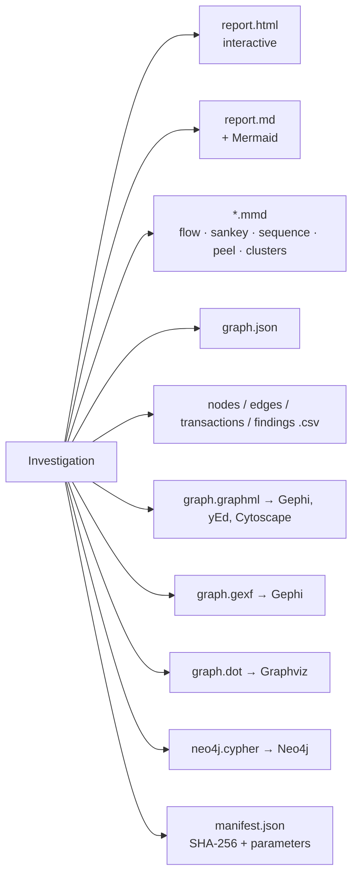

| File | Audience | Notes |
|---|---|---|
| `report.html` | Analysts | Single offline file. Tabs: Overview · Interactive graph · Flow diagram · Timeline · Findings · Clusters · Transactions · Addresses. Dark/light theme, PNG export, JSON download. Strict CSP, no network calls. |
| `report.md` | GitHub / tickets / wikis | Summary, risk table, findings, Mermaid flow + Sankey + sequence + peel + cluster diagrams, labeled-entity table, methodology |
| `*.mmd` | Docs | Individual Mermaid sources — paste into <https://mermaid.live> |
| `graph.json` | Pipelines | Full machine-readable investigation |
| `*.csv` | Spreadsheets / SIEM | Formula-injection-safe |
| `graph.graphml`, `graph.gexf` | Gephi, yEd, Cytoscape | Node attrs: category, taint, cluster, depth |
| `graph.dot` | Graphviz | `dot -Tsvg graph.dot -o graph.svg` |
| `neo4j.cypher` | Graph DB | `cat neo4j.cypher \| cypher-shell` |
| `manifest.json` | Evidence integrity | Tool version, UTC time, all parameters, label sources, SHA-256 of every file |

### Verify evidence integrity

```bash
cd case-001 && python3 - <<'PY'
import json, hashlib
m = json.load(open("manifest.json"))
for name, digest in m["files"].items():
    ok = hashlib.sha256(open(name, "rb").read()).hexdigest() == digest
    print("OK " if ok else "BAD", name)
PY
```

### Interactive report cheat-sheet

| Action | How |
|---|---|
| Move a node | drag it (physics re-settles) |
| Pan / zoom | drag background / mouse wheel |
| Inspect | click a node → side panel (labels, risk, counterparties, tx stats) |
| Jump | click any address link anywhere, or use the search box (Enter) |
| Filter | category chips, min edge value, max hop, hide unlabeled |
| Recolor | category / cluster / taint / hop depth |
| Layout | force-directed or layered by hop |

## 16. Project layout

```
tracex/
├── README.md  SECURITY.md  LICENSE  CONTRIBUTING.md
├── pyproject.toml  Dockerfile  Makefile
├── .github/workflows/ci.yml
├── examples/
│   ├── labels.sample.csv / .json
│   └── demo-output/                 ← pre-generated reports
├── docs/images/                     ← screenshots used in this README
├── src/tracex/
│   ├── cli.py            argparse CLI
│   ├── banner.py         start-up banner
│   ├── models.py         Tx / Leg, unit conversion
│   ├── graph.py          TxGraph (nodes, edges, proportional attribution)
│   ├── tracer.py         BFS tracer, hub/endpoint logic, depth placement
│   ├── heuristics.py     CIOH, CoinJoin, change, peel, pass-through, findings
│   ├── taint.py          haircut / poison
│   ├── risk.py           noisy-OR scoring
│   ├── labels.py         label DB + categories/weights
│   ├── analysis.py       Investigation (ties everything together)
│   ├── providers/        base, http, esplora, etherscan, demo
│   ├── reports/          html_report, markdown, mermaid, exporters
│   └── templates/report.html
└── tests/test_core.py
```

## 17. Limits, accuracy & false positives

- **Unlabeled ≠ innocent.** Only addresses present in your label files are attributed.
- **CIOH can over-merge** (PayJoin, custodial batching, some wallets) and **under-merge** (users who never co-spend).
- **Change detection is heuristic**; wallets that reuse addresses or send round change defeat it.
- **Peel/pass-through rules are conservative** and will miss slow or irregular layering.
- **Proportional edges are an attribution model**, not on-chain fact: a multi-input/multi-output tx doesn't record which input funded which output.
- **CoinJoin / mixers** break linkability; taint through them is diluted by design, not eliminated.
- **Bounded traces**: depth, `--max-txs`, `--max-nodes`, hub and endpoint rules mean the graph is a sample of reality. Truncation is reported on the console and in manifest parameters.
- **Hot wallets** (exchanges) are deliberately not expanded; tracing ends at the cash-out point, where legal process is the next step.
- Bitcoin L2s (Lightning), privacy coins (Monero, Zcash shielded) and cross-chain bridges are out of scope.

## 18. Development & testing

```bash
pip install -e ".[dev]"
pytest                    # unit + end-to-end (demo scenario, exports, XSS/CSV-injection guards)
ruff check src tests
make demo                 # regenerate examples/demo-output
```

The test-suite covers proportional edges, CoinJoin and change detection, haircut vs poison taint, the full demo investigation (clusters, peel chain, risk ≥ 90, CoinJoin not clustered), export validity (GraphML/GEXF parse), script-injection safety of the HTML report, CSV formula neutralisation, label validation, CLI banner, and HTTPS enforcement.

## 19. Roadmap

- [ ] ERC-20 / token transfer tracing
- [ ] Litecoin / Dogecoin / BCH providers (graph model already supports them)
- [ ] Tron & Solana providers
- [ ] FIFO / LIFO taint models, UTXO-level (vout-accurate) tracing
- [ ] Wasabi / Samourai-specific CoinJoin fingerprints
- [ ] STIX 2.1 and Maltego export
- [ ] Optional local web UI for case management

PRs welcome — see [CONTRIBUTING.md](CONTRIBUTING.md).

## 20. Legal, ethics & responsible use

TraceX analyses **public** data and is intended for compliance, incident response, journalism, research and law-enforcement support. You are responsible for lawful use in your jurisdiction. Do **not** use it to stalk, harass or dox people, to accuse individuals based on heuristics alone, or to evade sanctions. Keep investigation data confidential, record label provenance, and treat every finding as a lead requiring corroboration. See [SECURITY.md](SECURITY.md) for vulnerability reporting and the tool's threat model.

## 21. License & author

Released under the **MIT License** (see [LICENSE](LICENSE)).

**TraceX — by Aniket Misra**
