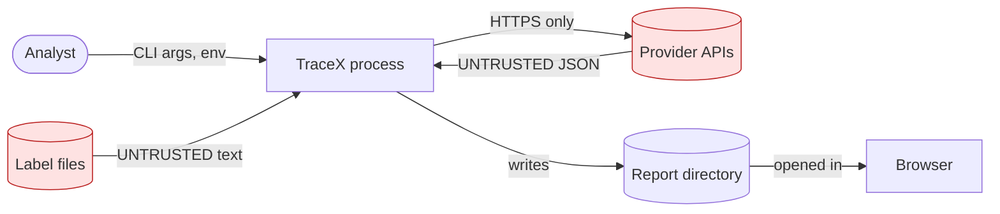

# Security Policy

TraceX is a **read-only analysis tool** for public blockchain data. It does not hold keys, sign or broadcast transactions, or connect to Tor hidden services. This document covers (1) how to report a vulnerability in TraceX, (2) the tool's threat model and built-in protections, (3) how to operate it safely, and (4) responsible-use expectations.

---

## 1. Supported versions

| Version | Supported |
|---|---|
| 1.0.x | ✅ security fixes |
| < 1.0 | ❌ |

## 2. Reporting a vulnerability

**Please do not open a public GitHub issue for security problems.**

1. Use GitHub's **"Report a vulnerability"** (Security → Advisories → *Report a vulnerability*) on this repository, **or**
2. Contact the maintainer, **Aniket Misra**, privately via the contact method on the GitHub profile (replace with a dedicated address, e.g. `security@your-domain`, before publishing).

Include: affected version / commit, a description and impact, minimal reproduction steps (a crafted label file or API response is ideal), and any suggested fix. Do not include real victim data or real wallet attributions.

**Response targets:** acknowledgement within 3 business days · triage within 7 days · fix or mitigation plan within 30 days for high-severity issues. Reporters are credited in the release notes unless they prefer otherwise. We ask for reasonable coordinated-disclosure time (90 days max) before public details.

### Safe harbour

Good-faith research that avoids privacy violations, service disruption and data destruction, and that targets **your own installation / test data**, will not be pursued. Do not run tests against third-party APIs (Blockstream, Etherscan, …) beyond normal usage; their terms apply.

### In scope

- Code execution, injection (HTML/JS, CSV/formula, XML, Cypher, DOT) via label files, API responses, CLI arguments or generated reports
- Secret leakage (API keys in logs, cache, reports, error messages)
- Path traversal / unsafe file writes, unsafe deserialization
- TLS / transport weakening, SSRF-style redirection of provider traffic
- Dependency or supply-chain issues in the packaging / CI / Docker files
- Report-integrity bypasses (manifest hash manipulation)

### Out of scope

- Inaccurate heuristics, false positives/negatives, or "wrong" risk scores (open a normal issue)
- Vulnerabilities in third-party data providers or in a browser
- Attacks that require an attacker who already controls the user's machine or Python environment
- Social-engineering, physical access, or denial of service by supplying an enormous but valid graph (documented limits apply)

---

## 3. Threat model

### 3.1 Assets

| Asset | Why it matters |
|---|---|
| Investigation targets (addresses/txids) | Reveals what you are investigating |
| Label files | May contain sensitive intelligence or case notes |
| API keys (`ETHERSCAN_API_KEY`) | Billing / quota abuse |
| Generated reports | May describe alleged illicit activity about real parties |
| Report integrity | Reports may be used as supporting material in a case |

### 3.2 Trust boundaries



Everything crossing from a red box into TraceX is treated as hostile: label files may come from third parties, and API responses can be tampered with by a malicious or compromised endpoint (including a self-hosted node you do not control).

### 3.3 Threats and mitigations (STRIDE-style)

| # | Threat | Vector | Mitigation in TraceX |
|---|---|---|---|
| T1 | **Stored XSS in the HTML report** | Malicious label `name`/`notes`/`source` such as `</script>` | Embedded JSON escapes `< > & U+2028/9`; all dynamic UI strings go through an `esc()` HTML-escaper; report ships a **strict CSP** (`default-src 'none'`, no network, no external scripts/styles); unit-tested |
| T2 | **CSV / spreadsheet formula injection** | Label name starting with `= + - @` | CSV writer prefixes `'` to dangerous cells in all CSV exports; unit-tested |
| T3 | **XML injection** (GraphML/GEXF) | Names with `<`, `&`, quotes | `xml.sax.saxutils.escape` / `quoteattr` on every value; tests parse the output |
| T4 | **Cypher / DOT injection** | Quotes in names | Values serialised with `json.dumps` (Cypher) and quote-stripping (DOT) |
| T5 | **Mermaid injection** | Brackets, quotes, `;`, `#` in names | Characters that carry Mermaid syntax are replaced before emission |
| T6 | **API key disclosure** | Key in URL → cache key, log, exception | Keys are sent as *secret params*: excluded from cache keys, never logged, never included in error text; cache files `chmod 600` |
| T7 | **Transport downgrade / MITM** | `http://` provider URL | Client **refuses non-HTTPS** base URLs; TLS verification is never disabled; redirects stay on urllib defaults |
| T8 | **Malicious / oversized API responses** | Giant JSON, malformed data | 20 MB response cap, timeouts, bounded retries, `json` parsing only (no pickle/eval/yaml-unsafe) |
| T9 | **Resource exhaustion** | Hub addresses, deep traces | Depth, per-address tx cap, node cap, hub threshold, endpoint stop-categories, pairwise-edge cap (2 500) |
| T10 | **Evidence tampering** | Editing output after generation | `manifest.json` records SHA-256 of every output + all parameters + label sources + tool version + UTC time. (Hashes alone do not prove authorship — sign the manifest, see §4.5.) |
| T11 | **Label poisoning** | Wrong/malicious labels cause false accusations | Labels carry `source` & `confidence`; validator warns on bad rows; reports always disclose that attribution is user-supplied |
| T12 | **Path traversal / overwrite** | Hostile output dir | Writes only fixed file names under the chosen directory; no names derived from untrusted data |
| T13 | **Supply chain** | Malicious dependency | **Zero runtime dependencies** (stdlib only); dev tools pinned by range; CI uses minimal permissions |
| T14 | **Deanonymisation of the analyst** | Provider sees your queries | Documented; use a self-hosted node and/or `--proxy`; local cache avoids repeat queries |

### 3.4 What TraceX deliberately does *not* do

- No execution of anything derived from input data (`eval`, `exec`, `pickle`, shell-outs).
- No telemetry, analytics or "phone home". The only network traffic is to the provider you choose.
- No JavaScript in reports loads remote code; the CSP blocks it even if injected.
- No automatic upload of labels, targets or reports anywhere.

---

## 4. Operating TraceX safely

### 4.1 Secrets

- Pass API keys **only through environment variables** (`ETHERSCAN_API_KEY`). Never commit them, never put them in label files or command history (`export` from a secrets manager or `read -s`).
- Use a **scoped, free-tier or revocable** key; rotate if you suspect exposure.
- In CI, use the platform's encrypted secrets; never echo them.
- If you use `--proxy`, remember the proxy operator can see destination hostnames and (for non-CONNECT proxies) potentially more — only use proxies you trust.

### 4.2 Data hygiene

- Treat the **report directory** as sensitive: it can contain target addresses, label notes and alleged-crime analysis. Store it encrypted (LUKS/FileVault/BitLocker) and restrict permissions (`chmod 700`).
- The response cache (`~/.cache/tracex`, override with `TRACEX_CACHE_DIR`) contains raw public ledger data for what you queried — which itself reveals your investigative interest. Clear it after sensitive cases: `rm -rf ~/.cache/tracex` or use `--no-cache`.
- Do not paste real label files, keys or victim details into GitHub issues, PRs or discussions.
- **Never commit** `*.csv` label packs with licensed/vendor data or case outputs to a public repo — `.gitignore` already excludes `tracex-report*/`, `case-*/`, `.env`, `labels.private.*`.

### 4.3 Opening reports

- Reports are single static files with CSP and no network access; still, open reports from untrusted sources only in a normal browser profile, not with extensions that inject scripts.
- Gephi/yEd/Neo4j importers are third-party software — keep them updated when loading files built from untrusted labels.

### 4.4 Running in a sandbox

For analysts handling hostile label data, run in a container with no extra privileges:

```bash
docker run --rm --read-only --cap-drop ALL --security-opt no-new-privileges \
  -v "$PWD/in:/in:ro" -v "$PWD/out:/out" tracex trace <addr> -l /in/labels.csv -o /out
```

(The provided Dockerfile already runs as an unprivileged user.)

### 4.5 Strengthening evidence integrity

`manifest.json` provides tamper-*evidence*, not tamper-*proofing*. For case work:

```bash
# sign the manifest so any change is detectable and attributable
gpg --armor --detach-sign case-001/manifest.json
# or, with minisign / cosign / age + a trusted timestamp service
```

Record the exact command line, tool version, provider and label-file hashes (the manifest already stores the first three), keep the raw provider responses (the cache) if you may need to reproduce results, and follow your organisation's chain-of-custody procedure.

### 4.6 Hardening checklist

- [ ] Python ≥ 3.9 from a trusted source; use a virtual environment
- [ ] Install from a tagged release and verify the commit/tag signature
- [ ] `pip install -e .` pulls **no** third-party runtime packages — verify with `pip list`
- [ ] API keys only in environment; `.env` is git-ignored
- [ ] Own Esplora node for sensitive investigations
- [ ] Output and cache directories encrypted and access-restricted
- [ ] Labels vetted, with source + confidence recorded
- [ ] Manifest signed before sharing a report
- [ ] Reports shared only with authorised parties (TLP / need-to-know markings)

---

## 5. Secure development practices (for contributors)

- No new **runtime** dependencies without maintainer approval and a stated need.
- Every string that originates outside the process (labels, API data, CLI args) must be sanitised for the sink it reaches (HTML, CSV, XML, Cypher, DOT, Mermaid, terminal). Add a test for each new sink.
- Never log or embed secrets; use `secret_params` in `HttpClient`.
- No `eval`, `exec`, `pickle`, `yaml.load`, `shell=True`, or dynamic imports from data.
- HTTP: HTTPS only, timeouts on every call, size caps on every read.
- Keep the report CSP at `default-src 'none'`; do not add remote scripts, fonts or images.
- Run `pytest` and `ruff` before opening a PR; CI also runs them on every push.
- Use signed commits for releases; enable GitHub **secret scanning**, **push protection**, **Dependabot** and **code scanning (CodeQL)** on the repository.

### Recommended GitHub repository settings

| Setting | Value |
|---|---|
| Branch protection on `main` | require PR + passing CI + review |
| Secret scanning + push protection | enabled |
| Dependabot alerts / updates (pip, GitHub Actions) | enabled |
| Private vulnerability reporting | enabled |
| Actions permissions | read-only token by default |

---

## 6. Responsible use & legal

TraceX analyses **public** information, but how you use the output matters.

- **Heuristics are not proof.** Never publicly accuse a person or organisation on the basis of a TraceX score or cluster. Corroborate with independent evidence and legal process.
- **Privacy & data protection.** Blockchain addresses can be personal data under laws such as the GDPR/UK GDPR, CCPA and India's DPDP Act when linked to an individual. Have a lawful basis, minimise retention, and protect outputs accordingly.
- **No harassment, doxxing or stalking.** Do not use TraceX to locate or target individuals.
- **No sanctions or AML evasion.** Do not use it to test or optimise evasion of controls.
- **Dark-web scope.** TraceX does not access Tor hidden services, marketplaces or illegal content. Do not extend it to do so in ways that violate the law of your jurisdiction.
- **Vulnerable data.** If your work touches child-exploitation-related or other highly sensitive material, stop and escalate to the appropriate authority (e.g. NCMEC, IWF, or national law enforcement) rather than analysing it independently.
- **Licences.** Respect the terms of any third-party label dataset or API you combine with TraceX.

## 7. Disclaimer

TraceX is provided **"as is"** under the MIT licence, without warranty of any kind. The authors are not liable for decisions made from its output. Nothing here is legal, financial or investigative advice.

---

*Maintainer: Aniket Misra · Last reviewed: 2026-11*
