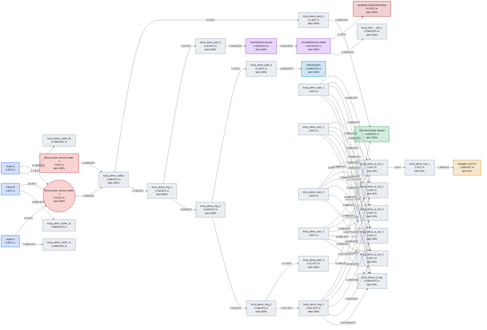
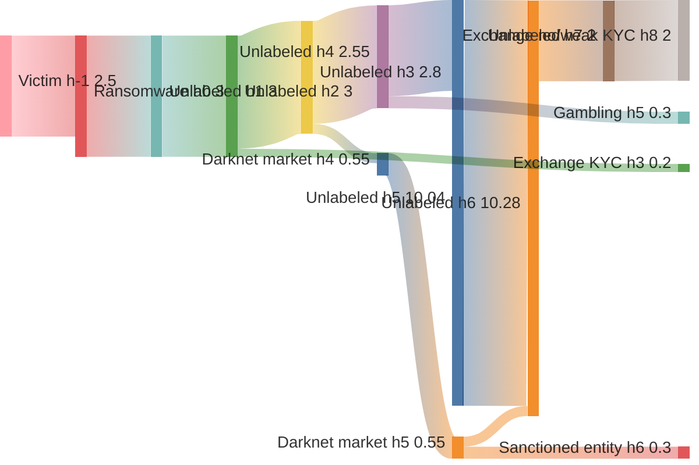
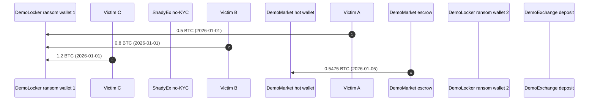
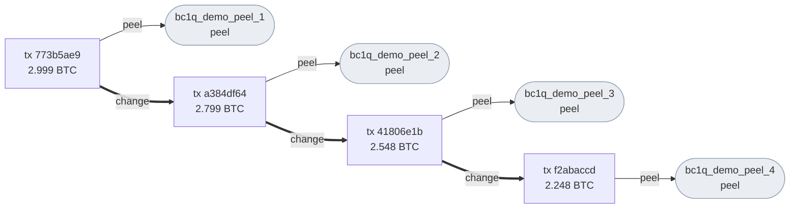
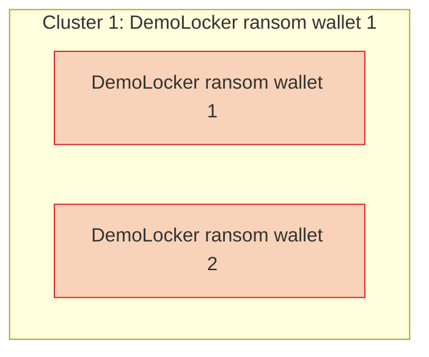

# TraceX Investigation Report

> Generated 2026-11-19T03:46:58Z · chain **BTC** · TraceX v1.0.0  
> ⚠️ Heuristic analysis of public ledger data. Findings are investigative leads, **not proof** of identity or wrongdoing.

## 1. Summary

| Metric | Value |
|---|---|
| Seeds | `bc1q_demo_ransom_1` |
| Addresses | 35 |
| Transactions | 17 |
| Edges | 55 |
| Labeled addresses | 11 |
| Clusters | 1 |
| CoinJoins | 1 |
| Peel chains | 1 |
| Total volume (BTC) | 34.175500 |
| Fees (BTC) | 0.009500 |
| Period | 2026-01-01 00:00:00 UTC → 2026-01-06 10:11:59 UTC |
| Tainted addresses | 25 |

## 2. Risk assessment

### 🔴 `bc1q_demo_ransom_1` — **100/100 (severe)**

| Risk factor | Detail | Contribution |
|---|---|---|
| Ransomware exposure | DemoLocker ransom wallet #1 (target) | 0.95 |
| Taint | 100.0% of received value traces to illicit sources | 0.90 |
| Darknet market exposure | DemoMarket escrow (4 hop(s)) | 0.26 |
| Layering | peel chain within 2 hops | 0.15 |
| Layering | rapid pass-through within 2 hops | 0.10 |
| Gambling exposure | DemoCasino (5 hop(s)) | 0.04 |
| Exchange (KYC) exposure | DemoExchange deposit (3 hop(s)) | 0.03 |

## 3. Findings

| Severity | Type | Finding | Detail |
|---|---|---|---|
| 🔴 critical | labeled_entity | Ransomware: DemoLocker ransom wallet #1 | Address bc1q_demo_ransom_1 is labeled 'DemoLocker ransom wallet #1' (ransomware, confidence 100%, source: TraceX synthetic demo) and appears in the traced flow. |
| 🔴 critical | labeled_entity | Ransomware: DemoLocker ransom wallet #2 | Address bc1q_demo_ransom_2 is labeled 'DemoLocker ransom wallet #2' (ransomware, confidence 100%, source: TraceX synthetic demo) and appears in the traced flow. |
| 🔴 critical | labeled_entity | Sanctioned entity: Synthetic sanctioned entity | Address bc1q_demo_sanctioned is labeled 'Synthetic sanctioned entity' (sanctioned, confidence 100%, source: TraceX synthetic demo) and appears in the traced flow. |
| 🟠 high | labeled_entity | Darknet market: DemoMarket escrow | Address bc1q_demo_market_1 is labeled 'DemoMarket escrow' (darknet_market, confidence 100%, source: TraceX synthetic demo) and appears in the traced flow. |
| 🟠 high | labeled_entity | Darknet market: DemoMarket hot wallet | Address bc1q_demo_market_hot is labeled 'DemoMarket hot wallet' (darknet_market, confidence 90%, source: TraceX synthetic demo) and appears in the traced flow. |
| 🟡 medium | coinjoin | CoinJoin / mixing transaction | 5 equal outputs of 2 BTC (5 inputs -> 6 outputs). Output links to inputs are deliberately ambiguous; downstream attribution confidence is reduced. |
| 🟡 medium | peel_chain | Peel chain of 4 hops | Large balance repeatedly split into a small 'peel' payment and a large change output; 0.96 BTC peeled in total. Peel endpoints: no labeled endpoints. |
| 🟡 medium | pass_through | 3 rapid pass-through address(es) | Addresses that forwarded >=90% of received funds within 60 minutes - typical of layering / relay wallets. |
| ℹ️ info | cluster | Address cluster #1 (2 addresses) | Addresses spent together as inputs of one transaction (common-input-ownership). Cluster inherits label: DemoLocker ransom wallet #1 [ransomware]. |

## 4. Money-flow diagram

## 5. Category flow (Sankey, by hop)

## 6. Chronological sequence

## 7.1 Peel chain (4 hops)

## 8. Address clusters

## 9. Labeled entities in scope

| Address | Entity | Category | Confidence | Source | Taint |
|---|---|---|---|---|---|
| `bc1q_demo_ransom_1` | DemoLocker ransom wallet #1 | Ransomware | 100% | TraceX synthetic demo | 100% |
| `bc1q_demo_ransom_2` | DemoLocker ransom wallet #2 | Ransomware | 100% | TraceX synthetic demo | 100% |
| `bc1q_demo_victim_1` | Victim A | Victim | 100% | TraceX synthetic demo | 0% |
| `bc1q_demo_victim_2` | Victim B | Victim | 100% | TraceX synthetic demo | 0% |
| `bc1q_demo_victim_3` | Victim C | Victim | 100% | TraceX synthetic demo | 0% |
| `bc1q_demo_exch_kyc` | DemoExchange deposit | Exchange (KYC) | 100% | TraceX synthetic demo | 100% |
| `bc1q_demo_market_1` | DemoMarket escrow | Darknet market | 100% | TraceX synthetic demo | 100% |
| `bc1q_demo_market_hot` | DemoMarket hot wallet | Darknet market | 90% | TraceX synthetic demo | 100% |
| `bc1q_demo_casino` | DemoCasino | Gambling | 100% | TraceX synthetic demo | 100% |
| `bc1q_demo_sanctioned` | Synthetic sanctioned entity | Sanctioned entity | 100% | TraceX synthetic demo | 100% |
| `bc1q_demo_exch_nokyc` | ShadyEx (no-KYC) | Exchange (no/weak KYC) | 80% | TraceX synthetic demo | 20% |

## 10. Largest transactions

| Time | Txid | In→Out | Total (BTC) | Flags |
|---|---|---|---|---|
| 2026-01-06 00:00:00 UTC | `c1126c99ec2dea0e…` | 5→6 | 10.036500 | coinjoin |
| 2026-01-02 06:00:00 UTC | `c003873192476dcd…` | 2→1 | 2.999000 |  |
| 2026-01-02 16:00:00 UTC | `773b5ae95eccba98…` | 1→2 | 2.998500 | peel |
| 2026-01-03 04:00:00 UTC | `a384df647ae273a1…` | 1→2 | 2.798000 | peel |
| 2026-01-03 22:00:00 UTC | `41806e1b303b5199…` | 1→2 | 2.547500 | peel |
| 2026-01-04 18:00:00 UTC | `f2abaccd87228073…` | 1→2 | 2.247000 | peel |
| 2026-01-01 09:00:00 UTC | `ba961be77dfcd8c2…` | 1→2 | 1.999500 |  |
| 2026-01-06 10:00:00 UTC | `2f828a82c8e864a4…` | 1→1 | 1.999500 |  |
| 2026-01-06 10:11:59 UTC | `8c8d1312fd5a777c…` | 1→1 | 1.999000 |  |
| 2026-01-01 05:00:00 UTC | `56969e35981f5ef8…` | 1→2 | 1.499500 |  |
| 2026-01-01 00:00:00 UTC | `e8c54b0c900e9df5…` | 1→2 | 0.999500 |  |
| 2026-01-05 04:00:00 UTC | `b61d7e76f2e6c754…` | 1→1 | 0.547500 |  |
| 2026-01-05 14:00:00 UTC | `0bfeb2f3d8d0c750…` | 1→2 | 0.546500 |  |
| 2026-01-04 00:00:00 UTC | `5f063cb75516f075…` | 1→1 | 0.299500 |  |
| 2026-01-03 06:00:00 UTC | `c9fd3ea2791971b7…` | 1→1 | 0.249500 |  |

## 11. Methodology & limitations

- Attribution comes **only** from the label files you supplied; unlabeled ≠ innocent.
- Common-input clustering is excluded for CoinJoins but can still over-merge (e.g., PayJoin).
- Change detection, peel chains and taint are probabilistic. Haircut taint is proportional; poison taint is worst-case.
- Traces are bounded by depth / transaction caps; see `manifest.json` for exact parameters.
- Do not treat output as legal evidence without independent corroboration and chain-of-custody review.
